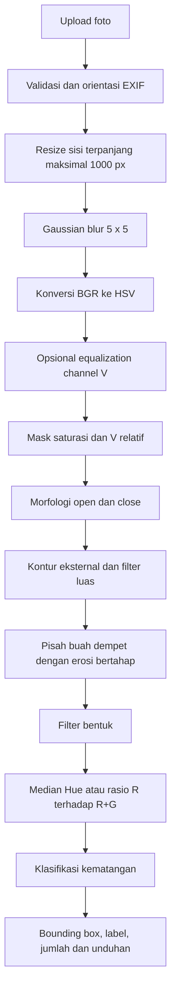

# Deteksi Tingkat Kematangan Buah Tomat Menggunakan Computer Vision

Website **Streamlit** untuk UTS Praktikum Visi Komputer B, Kelompok 5,
Departemen Informatika, FMIPA, Universitas Syiah Kuala.
Aplikasi mengadaptasi kode pada [`deteksi-kematangan-tomat.ipynb`](deteksi-kematangan-tomat.ipynb),
bukan menggantinya dengan model atau metode baru.

> **Status publikasi:** kode website siap dijalankan lokal. Repositori GitHub publik
> dan deployment Streamlit belum dibuat dari folder ini. Lihat petunjuk publikasi
> di bawah. Nama repo/subdomain yang disarankan: `deteksi-kematangan-tomat`.
> URL publik baru dapat dicantumkan setelah deployment berhasil.

## 1. Nama anggota tim dan NPM

| Nama | NPM |
|---|---|
| Rijaluddin Abdul Ghani | 2408107010008 |
| M. Ilham | 2408107010043 |
| Fathurrahman Pahmiputra | 2408107010069 |
| Muhammad Shidqi Hanif | 2408107010096 |

## 2. Deskripsi

Menentukan kematangan tomat dari perubahan warna kulit: **mentah** (hijau/kuning
kehijauan), **setengah matang** (oranye/campuran oranye-merah), dan **matang** (merah).
Metode klasik OpenCV menggunakan segmentasi HSV, kontur, serta ambang median Hue.
Tidak memerlukan GPU, pelatihan model, akun Google Drive, atau dataset saat inferensi.

### Fitur website

- Upload gambar JPG/JPEG, PNG, atau WEBP (maks. **10 MB / 24 MP**).
- Menampilkan **gambar asli dan gambar hasil berdampingan**.
- Bounding box, nomor objek, dan label kematangan pada setiap kandidat buah.
- Informasi **total buah, mentah, setengah matang, dan matang**.
- Tabel fitur setiap buah, mask segmentasi, dan histogram Hue per kelas prediksi.
- Unduhan gambar PNG, detail buah CSV, serta ringkasan jumlah dan parameter CSV.
- Pilihan konfigurasi default/tuned, klasifikasi HSV/BGR, dan equalization channel V.
- Perbandingan empat skenario pada foto yang diunggah serta tabel eksperimen laporan.
- Demo sintetis untuk mencoba aplikasi tanpa foto dataset; **bukan bukti akurasi**.

Gambar unggahan diproses di memori server, tidak ditulis ke disk oleh aplikasi.
Orientasi EXIF dikoreksi dan transparansi PNG/WEBP dikompositkan ke latar putih.

### Tampilan website


Cuplikan di atas memakai **demo sintetis**, bukan foto dataset evaluasi.

## 3. Pipeline



| Tahap | Parameter / metode konfigurasi tuned |
|---|---|
| Resize | Sisi terpanjang maksimal 1000 px; gambar kecil tidak diperbesar |
| Reduksi noise | Gaussian blur 5×5 |
| Segmentasi | `S ≥ 40`; `V ≤ int(0,80 × median V citra)` menggunakan `cv2.inRange` |
| Morfologi | Open, lalu close; kernel elips 5×5 |
| Kontur | `RETR_EXTERNAL`; luas minimum 0,004 × luas citra (0,4%) |
| Pemisahan dempet | Erosi bertahap 3×3, seed minimum 5% luas blob |
| Filter bentuk | Rasio sisi `minAreaRect ≤ 2,5`; ekstent minimum 0,5 |
| Ekstraksi fitur | Piksel jenuh di bagian dalam kontur yang dierosi 5×5 |
| HSV | Median `(Hue + 10) mod 180`, dibandingkan dengan ambang yang ikut digeser |
| BGR pembanding | Rasio rerata `R / (R + G + 1e-6)` |
| Output | Kotak, label, fitur, total dan jumlah tiap kelas |

**Rentang Hue OpenCV** (0–179) untuk konfigurasi tuned:

| Kelas | Rentang acuan |
|---|---|
| Matang | 0–7 dan 170–179 |
| Setengah matang | 8–11 |
| Mentah | 12–169 (kelas sisa dalam implementasi) |

Keputusan memakai median Hue tergeser per buah, bukan voting label piksel.
Hue merah 170–179 ditampilkan sebagai −10 sampai −1 pada histogram/tabel agar
rentang merah tersambung. Median dapat pecahan dan dibandingkan langsung dengan ambang.
Ambang tidak berarti semua objek berwarna pada rentang tersebut pasti tomat.

Konfigurasi default notebook berbeda: `s_min=50`, `v_rel=0.85`,
`h_setengah=12`. Aplikasi secara bawaan memakai **tuned**:
`s_min=40`, `v_rel=0.80`, `h_matang=7`, `h_setengah=11`.
Segmentasi **tetap HSV**, termasuk ketika metode klasifikasi BGR dipilih.

## 4. Dataset

Menurut [laporan kelompok](Laporan_Kelompok05.pdf), foto diambil sendiri oleh
Fathurrahman Pahmiputra pada **16 Oktober 2026** menggunakan kamera **Xiaomi 15T**,
dari atas pada jarak sekitar 30–45 cm, umumnya di atas latar putih.

| Kondisi | Foto | Kemunculan buah | Penggunaan |
|---|---:|---:|---|
| Ideal | 8 | 47 | Kalibrasi/tuning |
| Cahaya: lampu kuning dan dekat jendela | 8 | 30 | Uji |
| Sulit: berdempetan, latar/pencahayaan bervariasi | 4 | 23 | Uji |
| **Total** | **20** | **100** | |

Distribusi ground truth: **14 mentah, 42 setengah matang, 44 matang**.
Buah yang sama dipakai berulang pada foto berbeda; 100 kemunculan bukan 100 buah unik.
Tidak ada kelompok foto sudut tersendiri. Anotasi berupa jumlah per kelas,
bukan bounding box atau label tiap buah.

**Ketersediaan data:** foto asli belum ada pada folder proyek yang diberikan.
[`dataset/ground_truth.csv`](dataset/ground_truth.csv) ditranskripsi dari tabel
keluaran yang tersimpan pada notebook, bukan hasil anotasi baru. Tambahkan foto asli
dengan nama sesuai CSV untuk mereproduksi evaluasi. Lihat [`dataset/README.md`](dataset/README.md).
Aplikasi tetap berfungsi dengan foto unggahan sendiri tanpa dataset tersebut.

Histogram kalibrasi notebook memakai label sementara: buah diurutkan menurut median
Hue, lalu dibagi mengikuti jumlah kelas pada ground truth. Tuning hanya memakai
8 foto ideal, bukan 12 foto uji.

## 5. Hasil

**Tabel berikut bersumber dari laporan dan keluaran notebook yang tersimpan,
bukan evaluasi ulang website.** Foto asli belum tersedia untuk verifikasi ulang.

### Konfigurasi final (tuned)

| Kondisi | n foto | Akurasi total | Akurasi semua kelas | MAE total | MAE kelas |
|---|---:|---:|---:|---:|---:|
| Ideal | 8 | 100,0% | 62,5% | 0,00 | 0,25 |
| Cahaya | 8 | 100,0% | 37,5% | 0,00 | 0,67 |
| Sulit | 4 | 75,0% | 0,0% | 1,00 | 1,17 |
| **Semua** | **20** | **95,0%** | **40,0%** | **0,20** | **0,60** |

- **Akurasi total:** proporsi foto dengan jumlah total buah tepat.
- **Akurasi semua kelas:** proporsi foto dengan jumlah seluruh kelas sekaligus tepat.
  Angka ini **bukan akurasi klasifikasi per buah**.
- **MAE total:** rata-rata `abs(total prediksi − total GT)` per foto.
- **MAE kelas:** rata-rata galat absolut jumlah pada tiga kelas dan seluruh foto.

### Default dibanding tuned

| Konfigurasi | Himpunan | n | Akurasi total | Akurasi semua kelas | MAE kelas |
|---|---|---:|---:|---:|---:|
| Default | Kalibrasi | 8 | 100,0% | 62,5% | 0,25 |
| Default | Uji | 12 | 75,0% | 16,7% | 0,86 |
| Default | Semua | 20 | 85,0% | 35,0% | 0,62 |
| Tuned | Kalibrasi | 8 | 100,0% | 62,5% | 0,25 |
| Tuned | Uji | 12 | 91,7% | 25,0% | 0,83 |
| Tuned | Semua | 20 | 95,0% | 40,0% | 0,60 |

Tuning memperbaiki deteksi jumlah terutama melalui perubahan saturasi minimum dan batas V relatif.

## 6. Eksperimen pembanding

Pada notebook, ambang klasifikasi masing-masing skenario dituning dengan prosedur
yang sama pada foto kalibrasi. Hasil **ambang tuned**:

| Skenario | Akurasi total | Semua kelas (uji) | Semua kelas (semua) | MAE kelas |
|---|---:|---:|---:|---:|
| HSV | 95,0% | 25,0% | 40,0% | 0,60 |
| BGR | 95,0% | 0,0% | 10,0% | 1,37 |
| HSV + equalization V | 95,0% | 33,3% | 45,0% | 0,50 |
| BGR + equalization V | 95,0% | 25,0% | 35,0% | 0,87 |

HSV lebih baik untuk klasifikasi pada dataset ini. Perbaikan HSV setelah equalization
hanya satu foto dari 20, sehingga belum membuktikan signifikansi statistik.
Akurasi total sama pada dataset ini karena tahap segmentasi masih berbasis HSV;
kesamaan ini bukan jaminan untuk setiap gambar baru, terutama jika equalization diaktifkan.

**Perbandingan langsung di website berbeda dari evaluasi dataset:** empat skenario
memakai parameter sidebar yang sama, tanpa tuning ulang. Ambang BGR awal 0,50/0,75
berasal dari default notebook; ambang tuned BGR tiap skenario tidak tersimpan sebagai
konfigurasi final dalam berkas yang diberikan. Hasil unggahan hanya menunjukkan jumlah
prediksi, tidak mengklaim akurasi tanpa ground truth.

### Keterbatasan

- Rentang Hue antarkelas sempit dan sensitif terhadap cahaya/bayangan.
- Buah menumpuk rapat dapat menjadi satu kontur dan gagal dipisahkan.
- Objek berwarna lain dapat dianggap tomat; tidak ada model pengenal objek.
- Dataset kecil, buah berulang, dan label kelas tengah bersifat subjektif.
- Ground truth berbasis jumlah; precision/recall berbasis jumlah pada laporan hanya
  batas atas, bukan penilaian pencocokan deteksi per objek.
- Histogram dengan label sementara tidak membuktikan pemisahan kelas di dunia nyata.

## 7. Cara install di laptop lokal

Gunakan **Python 3.11 atau 3.12 versi stabil**. Jalankan perintah dari folder proyek.

### Windows (PowerShell / Command Prompt)

```powershell
python -m venv .venv
.venv\Scripts\python.exe -m pip install --upgrade pip
.venv\Scripts\python.exe -m pip install -r requirements.txt
.venv\Scripts\python.exe -m streamlit run app.py
```

Tidak perlu mengaktifkan virtual environment, sehingga tidak terhalang execution policy PowerShell.

### macOS / Linux

```bash
python3 -m venv .venv
.venv/bin/python -m pip install --upgrade pip
.venv/bin/python -m pip install -r requirements.txt
.venv/bin/python -m streamlit run app.py
```

Buka **http://localhost:8501**. Hentikan server dengan `Ctrl+C`.
Jika port terpakai, tambahkan `--server.port 8502` pada perintah Streamlit.
Gunakan paket `opencv-python-headless` pada requirements untuk server/cloud;
hindari memasang beberapa varian OpenCV sekaligus dalam environment yang sama.

### Cara menggunakan

1. Pilih tab **Analisis gambar**, kemudian unggah foto atau pilih **Demo sintetis**.
2. Lihat gambar asli/hasil, jumlah per kelas, dan tabel detail.
3. Sesuaikan konfigurasi di sidebar bila perlu, lalu klik **Terapkan parameter**.
4. Buka mask/histogram untuk memeriksa segmentasi dan unduh hasil PNG/CSV.
5. Aktifkan pembanding empat skenario bila ingin membandingkan jumlah prediksi.
6. Tab **Hasil & eksperimen** memuat hasil laporan; **Tentang & pipeline** memuat metode dan tim.

Tips: gunakan latar putih/abu terang, cahaya merata, objek tidak saling menutupi,
dan ambil foto dari atas. Bila tidak terdeteksi, coba naikkan batas V relatif atau
turunkan luas minimum. Parameter yang diubah tidak otomatis memiliki akurasi yang
sama dengan konfigurasi laporan.

### Menjalankan pengujian

Dengan Python dari virtual environment (contoh Windows):

```powershell
.venv\Scripts\python.exe -m unittest discover -s tests -v
```

Pengujian mencakup pipeline sintetis, batas Hue/rasio BGR, kesetaraan dengan fungsi
notebook pada demo, upload tidak valid, EXIF, transparansi, resize, pemisahan blob,
konsistensi ground truth, serta tampilan/interaksi Streamlit menggunakan AppTest.
Pengujian sintetis **bukan evaluasi akurasi pada foto asli**.

### Menjalankan notebook untuk evaluasi ulang

1. Tambahkan semua foto asli ke `dataset/` sesuai nama pada CSV.
2. Install Jupyter: `python -m pip install jupyter` dengan interpreter environment yang sama.
3. Jalankan `python -m jupyter notebook` dari folder proyek.
4. Buka notebook, pilih kernel environment tersebut, lalu **Restart & Run All**.
5. Notebook mencari dataset lokal terlebih dahulu dan menulis keluaran ke `output/`.
   Folder keluaran diabaikan Git; tambahkan hasil yang diperlukan secara selektif.

## 8. Referensi dan atribusi

1. OpenCV, [Changing Colorspaces](https://docs.opencv.org/4.x/df/d9d/tutorial_py_colorspaces.html).
2. Suzuki, S. & Abe, K. (1985). Topological structural analysis of digitized binary
   images by border following. *CVGIP*, 30(1), 32–46.
3. Gonzalez, R. C. & Woods, R. E. (2018). *Digital Image Processing*, edisi ke-4. Pearson.
4. Bradski, G. & Kaehler, A. (2008). *Learning OpenCV*. O'Reilly Media.
5. Hastie, T., Tibshirani, R. & Friedman, J. (2009). *The Elements of Statistical Learning*, edisi ke-2. Springer.
